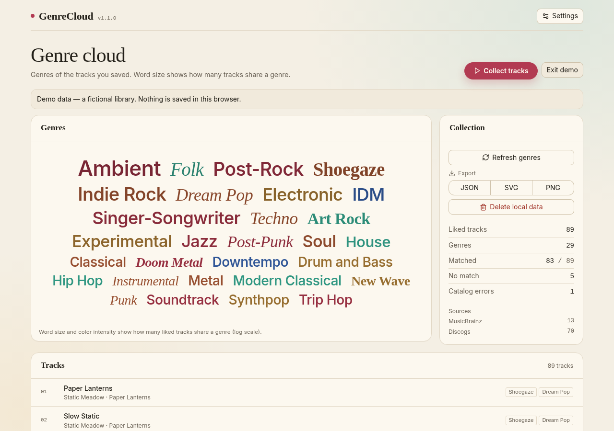
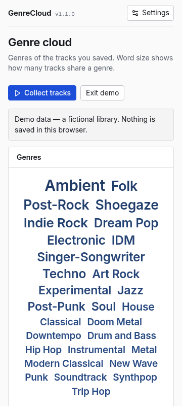
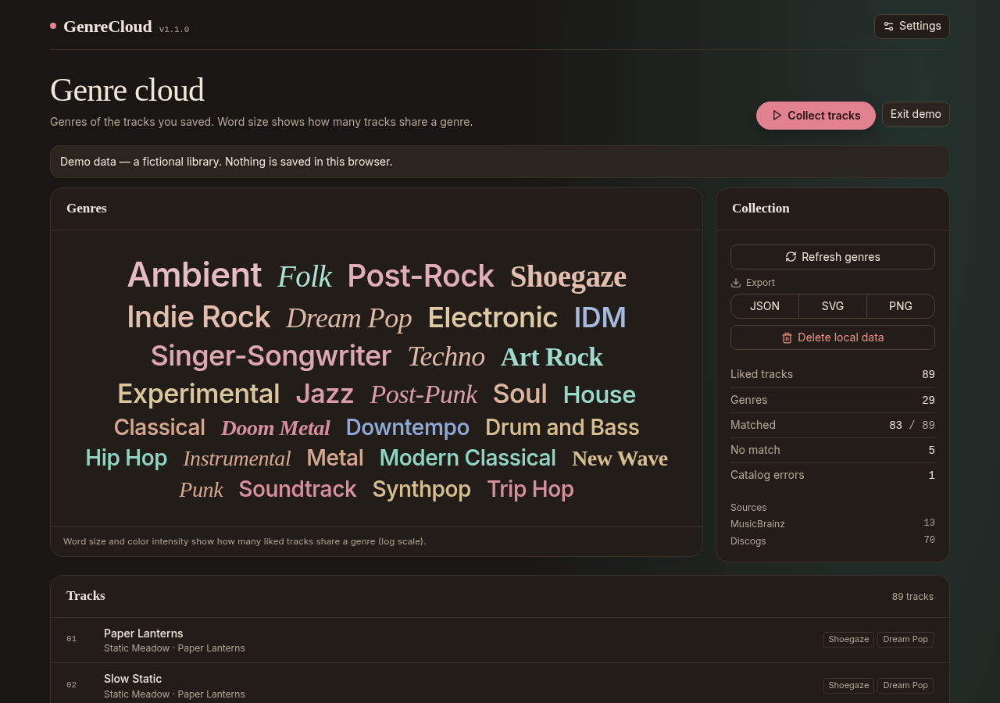

# GenreCloud

[](https://github.com/morishi/genrecloud/actions/workflows/ci.yml)
[](LICENSE)

A browser extension that builds a genre cloud from the tracks you saved (liked).
Word size is the number of your saved tracks that share a genre — not play
counts. Genres come from Discogs and MusicBrainz, with an instant first pass
from album genres.



## Status

| Source       | State                                         |
| ------------ | --------------------------------------------- |
| Yandex Music | Supported, tested on a real library           |
| Spotify      | **Experimental**, not tested on live accounts |
| Demo data    | Always available, no account needed           |

Genre catalogs: Discogs (release styles) and MusicBrainz (tags/genres). A
personal Discogs token is optional and raises the request limit.

## Features

- Collects all liked tracks from Yandex Music, or saved tracks from Spotify.
- Shows the cloud immediately from album genres, then refines it.
- Groups lookups by artist + album: one catalog request per album, shared by
  all its tracks.
- Discogs and MusicBrainz queues run in parallel with separate rate limits.
- Pause/resume, group progress and an ETA.
- Click a genre to filter the track list; keyboard accessible.
- Top-N (20/50/80/all), frequency→alphabet sorting.
- Export JSON, SVG and PNG.
- English and Russian UI, light and dark theme.
- No telemetry, no backend; data stays in `storage.local`.

## Install from source

Requirements: Node.js 20+, npm, and a browser profile where you are signed in
to Yandex Music (for that source).

```bash
npm ci
npm run build
```

Build outputs:

| Path                          | Purpose                            |
| ----------------------------- | ---------------------------------- |
| `dist/public/`                | Unpacked Chrome/Chromium extension |
| `dist/genrecloud-chrome.zip`  | Chrome package                     |
| `dist/firefox/`               | Unpacked Firefox extension         |
| `dist/genrecloud-firefox.zip` | Firefox package                    |
| `dist/SHA256SUMS.txt`         | Checksums of both archives         |

Chrome / Chromium / Edge:

1. Open `chrome://extensions` and enable Developer mode.
2. Choose "Load unpacked" and select `dist/public`.
3. Open `https://music.yandex.ru` in a tab and sign in.
4. Click the GenreCloud toolbar button. A full tab opens; press "Collect tracks".

Firefox 128+:

1. Open `about:debugging#/runtime/this-firefox`.
2. "Load Temporary Add-on…" → `dist/firefox/manifest.json`.
3. Open Yandex Music, sign in, click the toolbar button.

The temporary add-on disappears when Firefox restarts; a permanent install
requires signing on AMO. For development, `npx web-ext run --source-dir dist/firefox`
works too.

After updating the extension, reload **both** the GenreCloud tab and the Yandex
Music tab: the browser keeps the old content script until the page reloads.

## Configuration

Open **Settings** in the app.

### Discogs token (optional)

Without a token Discogs allows about 25 requests/minute; with a personal token, 60. Create one at <https://www.discogs.com/settings/developers> and paste it
into Settings. It is stored in `storage.local`, never exported and never
logged. The app explains where to get it.

### Spotify (experimental)

Spotify needs your own Client ID. There is no shared Client ID in this
repository, because Development Mode apps require Spotify Premium for the
owner and are limited to five users.

1. Open <https://developer.spotify.com/dashboard> and create an app.
2. In the app settings add the redirect URI shown in GenreCloud Settings
   (it is `https://<extension-id>.chromiumapp.org/` in Chromium browsers and
   `https://<extension-uuid>.extensions.allizom.org/` in Firefox). The exact
   value is generated by the browser; copy it from the app.
3. Paste the Client ID into Settings, enable Spotify, press "Connect Spotify".
4. Approve the `user-library-read` scope, then collect tracks.

Authorization uses Authorization Code + PKCE. No client secret exists in the
extension. Tokens live in `storage.local`; "Disconnect" removes them.

Spotify reports artist genres are deprecated and frequently empty; GenreCloud
falls back to Discogs and MusicBrainz for those artists. Batch endpoints were
removed from Development Mode, so artist lookups are deduplicated and issued
one by one through the shared rate limiter. See
[`PUBLISH-CHECKLIST.md`](PUBLISH-CHECKLIST.md) for the open policy question.

## How it works

```
Yandex Music tab (content script)          GenreCloud tab (React)
  page-world fetch, own cookies  ───────►  collect → group by artist+album
  fallback: DOM scroll                      │
                                            ├─ instant cloud from album genres
                                            ├─ Discogs queue  ─┐ parallel,
                                            └─ MusicBrainz queue ┘ rate-limited
                                                    │
                                            results → cloud, table, exports
```

- One track contributes at most one vote per genre.
- Discogs styles replace the coarse album genre; MusicBrainz is used when
  Discogs has nothing.
- Genre variants are merged (`hip hop`/`hip-hop`, `synthpop`/`synth-pop`, …).
- Misses are cached locally for 30 days; results are saved every few groups.

Performance on a deterministic 686-track fixture
(see [`docs/PERFORMANCE.md`](docs/PERFORMANCE.md)):

| Metric             | Per-track baseline | Grouped |
| ------------------ | -----------------: | ------: |
| Simulated duration |           32.4 min | 8.7 min |
| Discogs requests   |                686 |     209 |

That is 3.74× faster. Discogs is the bottleneck; a personal token roughly
halves the grouped time.

## Privacy

Everything is local: no backend, account, analytics or remote code. Only
artist, album and track title are sent to Discogs and MusicBrainz; Spotify
requests go to the official API only when you connect it. Details and the list
of storage keys: [`PRIVACY.md`](PRIVACY.md). Permissions are justified in
[`docs/PERMISSIONS.md`](docs/PERMISSIONS.md).

## Development

```bash
npm run dev          # Vite dev server; use "Try demo data"
npm run lint
npm run format:check
npm run typecheck
npm test
npm run bench        # deterministic lookup benchmark
npm run build
```

Tests use Vitest, including a mock Spotify server and contract tests for
pagination, token refresh and rate limits.

## Contributing

See [`CONTRIBUTING.md`](CONTRIBUTING.md) and the
[`CODE_OF_CONDUCT.md`](CODE_OF_CONDUCT.md). Security reports go through
[`SECURITY.md`](SECURITY.md). Please never post real tokens or library exports.

## Disclaimer

GenreCloud is an unofficial project. It is not affiliated with, endorsed by or
sponsored by Yandex, Spotify, Discogs or MetaBrainz. Names and trademarks
belong to their owners.

The Yandex Music integration uses an internal API of the web player, which may
change or be closed at any time. Spotify support is experimental. You are
responsible for complying with the terms of the services you use; the extension
is intended for personal, non-commercial use with your own accounts.

Data licenses: MusicBrainz core data is CC0; community-contributed genres and
tags are CC BY-NC-SA. Discogs data is subject to the Discogs API terms. Do not
redistribute catalog databases built with this tool. See
[`THIRD_PARTY_NOTICES.md`](THIRD_PARTY_NOTICES.md).

## Screenshots

| Light, 360 px                                        | Dark, 1280 px                                        |
| ---------------------------------------------------- | ---------------------------------------------------- |
|  |  |

Screenshots use the built-in demo library, not a real account.
