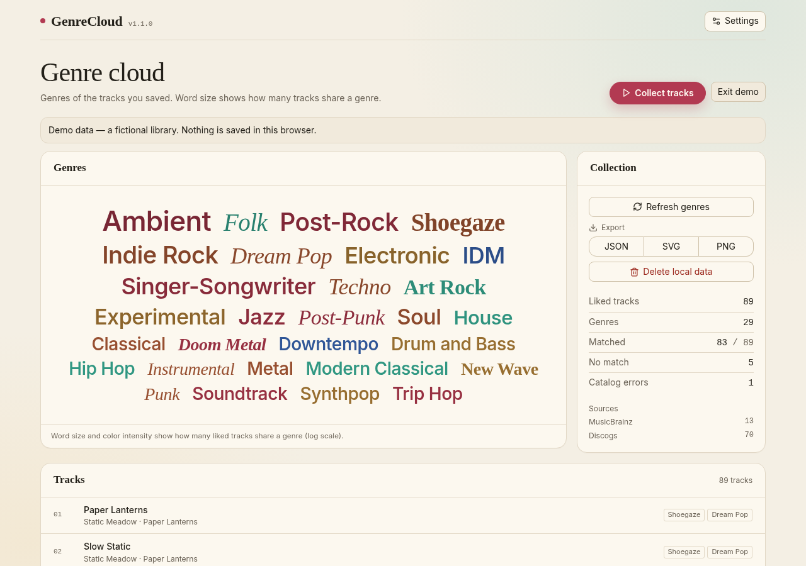
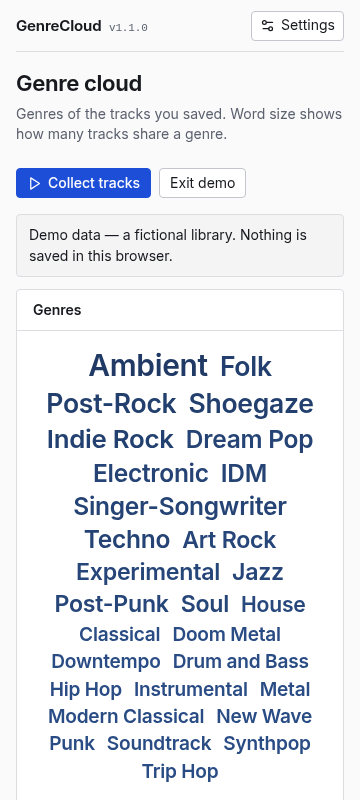
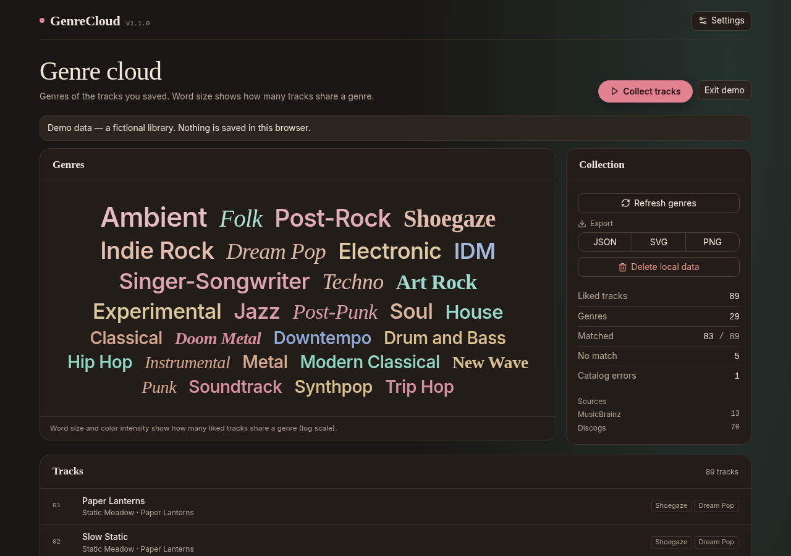

# GenreCloud

[](https://github.com/mor1shi/GenreCloud/actions/workflows/ci.yml)
[](LICENSE)

Расширение для браузера, которое строит облако жанров по сохранённым
(«любимым») трекам. Размер слова — число ваших треков этого жанра, а не
количество прослушиваний. Жанры берутся из Discogs и MusicBrainz; первая
версия облака появляется сразу по жанрам альбомов.



## Статус

| Источник      | Состояние                                               |
| ------------- | ------------------------------------------------------- |
| Яндекс Музыка | Поддерживается, проверено на реальной библиотеке        |
| Spotify       | **Экспериментально**, на живых аккаунтах не проверялось |
| Демо-данные   | Доступны всегда, аккаунт не нужен                       |

## Возможности

- Собирает все лайки Яндекс Музыки или сохранённые треки Spotify.
- Сразу рисует облако по жанрам альбомов, затем уточняет его.
- Один запрос в каталог на пару «исполнитель + альбом», результат общий для
  всех треков альбома.
- Очереди Discogs и MusicBrainz работают параллельно со своими лимитами.
- Пауза и продолжение, прогресс по группам, оценка оставшегося времени.
- Клик по жанру фильтрует список; управление с клавиатуры.
- Топ-N (20/50/80/все), сортировка по частоте, затем по алфавиту.
- Экспорт JSON, SVG и PNG.
- Интерфейс на английском и русском, светлая и тёмная тема.
- Без телеметрии и сервера; данные остаются в `storage.local`.

## Установка из исходников

Нужны Node.js 20+, npm и вход в Яндекс Музыку в браузере (для этого источника).

```bash
npm ci
npm run build
```

Результат:

| Путь                          | Назначение                       |
| ----------------------------- | -------------------------------- |
| `dist/public/`                | Распакованное расширение Chrome  |
| `dist/genrecloud-chrome.zip`  | Архив Chrome                     |
| `dist/firefox/`               | Распакованное расширение Firefox |
| `dist/genrecloud-firefox.zip` | Архив Firefox                    |
| `dist/SHA256SUMS.txt`         | Контрольные суммы                |

Chrome / Chromium / Edge:

1. `chrome://extensions` → режим разработчика.
2. «Загрузить распакованное» → `dist/public`.
3. Откройте `https://music.yandex.ru` и войдите в аккаунт.
4. Нажмите на иконку GenreCloud — откроется вкладка, нажмите «Собрать треки».

Firefox 128+:

1. `about:debugging#/runtime/this-firefox`.
2. «Load Temporary Add-on…» → `dist/firefox/manifest.json`.
3. Откройте Яндекс Музыку, войдите, нажмите на иконку.

Временное дополнение исчезает после перезапуска Firefox; для постоянной
установки нужна подпись на AMO. Для разработки: `npx web-ext run --source-dir dist/firefox`.

После обновления расширения перезагрузите и вкладку GenreCloud, и вкладку
Яндекс Музыки: браузер держит старый content script до перезагрузки страницы.

## Настройка

Откройте **Settings** в приложении.

### Токен Discogs (необязательно)

Без токена Discogs разрешает около 25 запросов в минуту, с личным токеном — 60. Создайте токен на <https://www.discogs.com/settings/developers> и вставьте
его в настройках. Он хранится только в `storage.local`, не попадает в экспорт
и логи.

### Spotify (экспериментально)

Нужен собственный Client ID: в репозитории нет общего, потому что приложения
в Development Mode требуют Premium у владельца и ограничены пятью
пользователями.

1. Создайте приложение на <https://developer.spotify.com/dashboard>.
2. Добавьте redirect URI, который показан в настройках GenreCloud
   (`https://<id-расширения>.chromiumapp.org/` в Chromium,
   `https://<uuid>.extensions.allizom.org/` в Firefox). Точное значение
   показывает само приложение.
3. Вставьте Client ID в настройки, включите Spotify и нажмите «Connect Spotify».
4. Разрешите scope `user-library-read` и запустите сбор.

Используется Authorization Code + PKCE, client secret в расширении нет.
Токены лежат в `storage.local`; кнопка «Disconnect» их удаляет.

Spotify помечает жанры исполнителя как устаревшие, и они часто пусты —
тогда используются Discogs и MusicBrainz. Пакетные эндпоинты в Development
Mode удалены, поэтому запросы по артистам дедуплицируются и идут по одному
через общий rate limiter. Открытый юридический вопрос описан в
[`PUBLISH-CHECKLIST.md`](PUBLISH-CHECKLIST.md).

## Как это работает

```
Вкладка Яндекс Музыки (content script)     Вкладка GenreCloud (React)
  запрос из контекста страницы  ─────────►  сбор → группировка исполнитель+альбом
  резерв: прокрутка DOM                     │
                                            ├─ мгновенное облако по жанрам альбомов
                                            ├─ очередь Discogs   ─┐ параллельно,
                                            └─ очередь MusicBrainz┘ с лимитами
                                                    │
                                            облако, таблица, экспорт
```

- Один трек даёт не больше одного голоса за жанр.
- Стили Discogs заменяют грубый жанр альбома; MusicBrainz используется, если
  Discogs ничего не нашёл.
- Варианты названий сливаются (`hip hop`/`hip-hop`, `synthpop`/`synth-pop`).
- Промахи кэшируются локально на 30 дней, результат сохраняется каждые
  несколько групп.

Замер на фикстуре из 686 треков (подробнее в
[`docs/PERFORMANCE.md`](docs/PERFORMANCE.md)):

| Метрика            | По трекам (было) | По группам |
| ------------------ | ---------------: | ---------: |
| Длительность       |         32,4 мин |    8,7 мин |
| Запросов к Discogs |              686 |        209 |

Ускорение 3,74×. Узкое место — Discogs; личный токен сокращает время примерно
вдвое.

## Приватность

Всё локально: нет сервера, аккаунта, аналитики и удалённого кода. В Discogs и
MusicBrainz уходят только исполнитель, альбом и название трека; запросы к
Spotify идут только в официальный API и только после подключения. Список
ключей хранения и детали — в [`PRIVACY.md`](PRIVACY.md), обоснование
разрешений — в [`docs/PERMISSIONS.md`](docs/PERMISSIONS.md).

## Разработка

```bash
npm run dev          # Vite; демо-данные доступны без расширения
npm run lint
npm run format:check
npm run typecheck
npm test
npm run bench        # детерминированный бенчмарк поиска
npm run build
```

Тесты на Vitest: мок-сервер Spotify, контрактные тесты пагинации, refresh и
лимитов.

## Участие

См. [`CONTRIBUTING.md`](CONTRIBUTING.md) и
[`CODE_OF_CONDUCT.md`](CODE_OF_CONDUCT.md). Об уязвимостях — через
[`SECURITY.md`](SECURITY.md). Не публикуйте реальные токены и выгрузки
библиотеки.

## Отказ от ответственности

GenreCloud — неофициальный проект. Он не связан с Яндексом, Spotify, Discogs
или MetaBrainz и не одобрен ими; названия и торговые марки принадлежат
владельцам.

Интеграция с Яндекс Музыкой использует внутренний API веб-плеера, который
может измениться или быть закрыт. Поддержка Spotify экспериментальна. Вы сами
отвечаете за соблюдение условий сервисов; расширение предназначено для
личного некоммерческого использования с собственными аккаунтами.

Лицензии данных: основные данные MusicBrainz — CC0, жанры и теги сообщества —
CC BY-NC-SA. Данные Discogs подпадают под условия Discogs API. Не
распространяйте базы каталогов, собранные этим инструментом. Подробнее —
[`THIRD_PARTY_NOTICES.md`](THIRD_PARTY_NOTICES.md).

## Скриншоты

| Светлая, 360 px                                           | Тёмная, 1280 px                                           |
| --------------------------------------------------------- | --------------------------------------------------------- |
|  |  |

Скриншоты сделаны на встроенной демо-библиотеке, не на реальном аккаунте.
